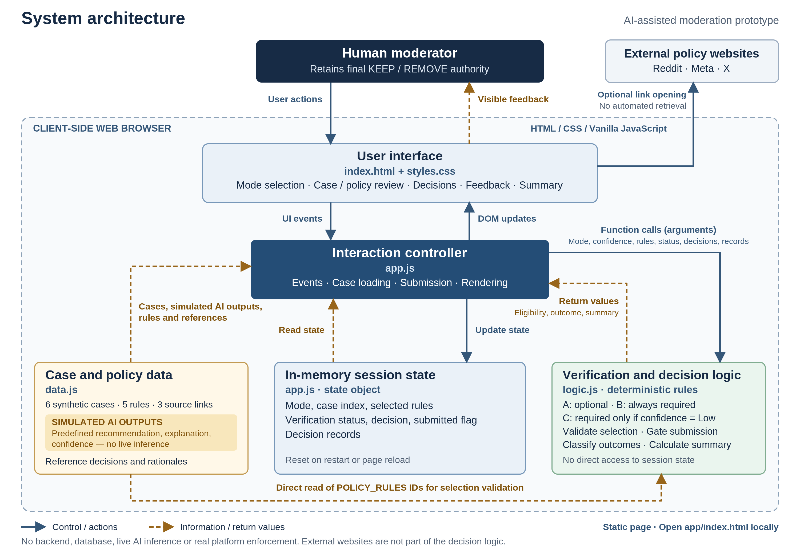

# System Architecture

## 1. Technology Stack

The implemented prototype is a lightweight,
client-side interactive system.

- HTML: interface structure and semantic elements.
- CSS: responsive layout and visual feedback.
- Vanilla JavaScript: interaction control,
  state management and decision logic.
- Structured JavaScript data: synthetic cases,
  simulated AI outputs and moderation rules.
- Git: version control and development evidence.

The prototype runs locally in a web browser
by opening app/index.html.

No backend server, database, external AI API
or additional software dependencies are required.

## 2. System Components

### Human Moderator

Reviews the original post, comment, simulated
AI assessment and relevant moderation rules.

The moderator retains control over the final
KEEP or REMOVE decision.

### User Interface

Implemented in index.html and styles.css.

Provides four main screens:

- Welcome
- Mode Selection
- Moderation Workspace
- Session Summary

The interface presents case information,
AI explanations, verification requirements,
decision controls and outcome feedback.

### Case and Policy Data

Implemented in data.js.

Contains:

- Six synthetic moderation cases.
- Five adapted moderation rules.
- Three external policy source links.
- Predefined AI recommendations and explanations.
- Simulated High and Low confidence labels.
- Predefined reference decisions and rationales.

The AI outputs are fixed simulation data,
not results of live model inference.

### Interaction Controller

Implemented in app.js.

Manages user events, screen transitions,
case progression, policy selection,
verification status, decision submission
and interface rendering.

It coordinates data, session state
and decision logic.

### Verification and Decision Logic

Implemented in logic.js.

The main functions are:

- requiresVerification()
- isValidVerification()
- isDecisionAvailable()
- canSubmitDecision()
- getDecisionOutcome()
- calculateSessionSummary()

The controller passes the required values
to these functions as arguments.

The logic functions do not directly access
or modify the session state.

The verification validation function directly
reads POLICY_RULES from data.js to check
whether selected rule identifiers are valid.

### In-memory Session State

Managed within app.js.

Stores:

- Selected interaction mode.
- Current case index.
- Selected moderation rules.
- Verification completion status.
- Current user decision.
- Submission status.
- Completed case records.

Session data is temporary and is not stored
in a persistent database.

### External Policy Sources

The interface provides links to policy
information from Reddit, Meta and X.

These websites are available for voluntary
human consultation.

The system does not automatically retrieve,
analyse or process external policy content.

## 3. Information and Control Flow

1. The moderator selects an interaction mode.
2. The controller loads a predefined case.
3. The controller passes the mode and simulated
   confidence to the verification logic.
4. The logic returns the verification requirement.
5. The interface displays the case, simulated
   AI assessment and available actions.
6. The moderator reviews the policy voluntarily
   or completes verification when required.
7. The controller validates the selected rules
   and updates the interaction state.
8. The moderator selects and submits a final
   KEEP or REMOVE decision.
9. The decision logic compares the user decision,
   AI recommendation and reference decision.
10. The controller stores the record and
    displays decision feedback.
11. The next case is loaded or the final
    session summary is displayed.

User actions and visible system feedback
form a continuous interaction loop.

The reference decision is not used to trigger
verification or determine which final decision
the moderator is allowed to select.

## 4. Implemented File Structure

| File | Responsibility |
|---|---|
| app/index.html | Interface structure |
| app/styles.css | Responsive layout and feedback |
| app/data.js | Case data and moderation policy |
| app/logic.js | Verification and decision logic |
| app/app.js | Interaction control and session state |

The JavaScript files are loaded in this order:

1. data.js
2. logic.js
3. app.js

This loading sequence makes the predefined data
and decision functions available to the controller.

## 5. Intelligent Behaviour

The implemented adaptive behaviour is based
on deterministic verification rules.

| Interaction mode | High confidence | Low confidence |
|---|---|---|
| Mode A - Explanation Only | Optional | Optional |
| Mode B - Mandatory Verification | Required | Required |
| Mode C - Selective Verification | Optional | Required |

When verification is mandatory, the final
decision controls remain unavailable until
verification is completed.

The moderator may select relevant policy rules
or indicate uncertainty using Not sure.

All three modes retain voluntary access
to the moderation policy.

Verification completion confirms completion
of the interaction step, not the correctness
of the selected rules.

High simulated confidence does not guarantee
a correct AI recommendation.

The intelligent behaviour is therefore
rule-based interaction adaptation, rather
than autonomous content classification.

## 6. Technical Design Rationale

A client-side architecture was selected
to reduce implementation complexity and
focus development on human-AI interaction.

Separating data, decision logic and interface
control supports maintainability, inspection
and functional testing.

Predefined AI outputs allow consistent
demonstration of both correct and incorrect
recommendations across interaction modes.

The responsive policy layout, expandable
case context and dynamic verification
feedback were introduced during design
iteration.

These refinements were intended to improve
information accessibility and the visibility
of system states.

The architecture supports human control
rather than automatic acceptance of AI advice.

## 7. Technical Limitations

- No live AI moderation model is connected.
- AI confidence labels are simulated and
  are not calibrated model probabilities.
- All six cases are predefined synthetic examples.
- Reference decisions have not been
  independently validated.
- Reference answers are hidden by the interface,
  not protected through server-side access control.
- Verification completion does not establish
  that a moderator has understood the policy.
- Session records are stored in memory and
  are cleared when the page is reloaded
  or a new session is started.
- No real social media content is removed.
- Session records do not directly measure trust
  or cognitive effort.

## 8. Implementation Status

The browser-based prototype implements
the three interaction modes, policy review,
verification controls, human decision-making,
outcome feedback and session summaries.

The AI recommendations, explanations
and confidence levels remain simulated.

Functional testing and design iteration
are documented in TESTING.md.

The final architecture diagram represents
the implemented system rather than
a proposed future architecture.

The editable vector version is available at:

[System Architecture - SVG](diagrams/system-architecture.svg)

The initial architecture design remains
available in the Git development history.