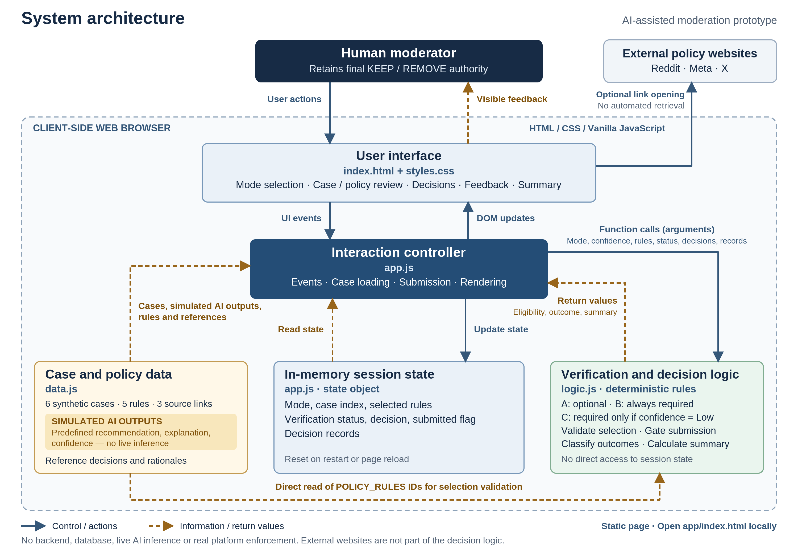

# AI-assisted Moderation

Human-AI Decision-Making Prototype

Intelligent Interactive Systems - A2
University of Birmingham

Report word count: To be confirmed in the final report.

## 1. Project Overview

This project explores how AI explanations and
verification prompts can support appropriate
reliance on AI recommendations in social media
content moderation.

The interaction problem is that people may find
it difficult to decide whether to trust or rely
on AI recommendations when the system does not
clearly explain how it reaches its decisions.

The prototype focuses on identity-related
content moderation involving ethnicity,
gender and disability, with non-professional
moderators as the initial target users.

The aim is to explore the balance between
verification requirements, human decision
control and unnecessary cognitive effort.

## 2. How to Run

1. Download or clone this repository.
2. Keep all files in the app folder together.
3. Open app/index.html in a desktop web browser.
4. Click Get Started.
5. Select an interaction mode.
6. Complete the six moderation cases.
7. Review the session summary.

No installation, backend server, API key
or additional software package is required.

The prototype was manually tested in Chrome.

## 3. Interaction Modes

| Mode | Verification requirement |
|---|---|
| A - Explanation Only | Optional for every case |
| B - Mandatory Verification | Required for every case |
| C - Selective Verification | Required when simulated confidence is Low; otherwise optional |

Mode C is the main design focus.

All three modes allow access to moderation
policy information and retain human authority
over the final KEEP or REMOVE decision.

## 4. Implementation Status

### Implemented

- Four main interaction screens.
- Six synthetic moderation cases.
- Five adapted moderation rules.
- Three interaction modes.
- Mandatory and voluntary verification.
- Policy rule selection and editing.
- Expandable case context.
- Dynamic verification feedback.
- Human decision submission.
- Individual case feedback.
- Session summaries.

### Simulated

- AI recommendations.
- AI explanations.
- High and Low confidence labels.
- Social media moderation scenarios.

### Outside the Current Scope

- Live AI inference and model training.
- Real social media platform integration.
- Persistent data storage.
- Formal user evaluation.

## 5. System Architecture

The prototype uses HTML, CSS and Vanilla
JavaScript.

Case data, decision logic and interaction
control are separated into different files.

Session state is managed in browser memory.

See [ARCHITECTURE.md](ARCHITECTURE.md)
for technical details and limitations.

## 6. Interaction Storyboards

The three storyboards illustrate different
interaction paths within Mode C.

### Storyboard 01 - Voluntary Verification

Case C01 demonstrates voluntary policy
verification and acceptance of a simulated
AI recommendation that matches the reference.

[View Storyboard 01](storyboards/storyboard-01-C01.png)

### Storyboard 02 - Error Recovery

Case C02 demonstrates mandatory verification
triggered by low simulated confidence and
human correction of an incorrect recommendation.

[View Storyboard 02](storyboards/storyboard-02-C02.png)

### Storyboard 03 - System Limitation and Human Control

Case C04 demonstrates that high simulated
confidence does not guarantee correctness.

The moderator voluntarily reviews the policy
and overrides an incorrect AI recommendation.

[View Storyboard 03](storyboards/storyboard-03-C04.png)

The storyboards are AI-assisted scenario
illustrations based on prototype screenshots.
The illustrated characters and their thoughts
are fictional, not observations of participants.

## 7. Project Documentation

| Document | Purpose |
|---|---|
| [PROJECT.md](PROJECT.md) | Project definition and development record |
| [REQUIREMENTS.md](REQUIREMENTS.md) | Functional requirements and design constraints |
| [POLICY.md](POLICY.md) | Adapted moderation rules and sources |
| [CASES.md](CASES.md) | Synthetic cases and reference decisions |
| [INTERACTION.md](INTERACTION.md) | Interaction design and verification logic |
| [ARCHITECTURE.md](ARCHITECTURE.md) | Implemented system architecture |
| [TESTING.md](TESTING.md) | Functional testing and design iteration |

## 8. Development Evidence

| Commit | Development milestone |
|---|---|
| 225fbcf | Initial project design and architecture |
| 5dbe9f9 | Interactive prototype and functional testing |
| 426c27e | Verification feedback and information accessibility refinements |
| db289d2 | Interaction storyboards and final architecture |

Manual testing included verification
requirements, decision controls, feedback
and session summary consistency.

Two interface refinements addressed
verification state visibility and access
to case context during policy review.

Detailed observations, checks and limitations
are recorded in TESTING.md.

## 9. AI Assistance and Authorship

Generative AI was used to assist with design
exploration, code generation, debugging,
documentation and visual illustrations.

The developer reviewed design proposals,
selected the project scope, created and
modified local project files, performed
manual functional testing and maintained
the Git development history.

AI-assisted outputs were reviewed against
the project requirements and available
prototype evidence.

The moderation policy is adapted from
external policy sources documented in
POLICY.md.

## 10. Limitations

AI confidence labels are predefined rather
than calibrated model probabilities.

Reference decisions are predefined under
the prototype policy and have not been
independently validated.

Verification completion does not establish
policy comprehension.

Session records describe decision and
verification behaviour, rather than directly
measuring trust or cognitive effort.

No formal user study was conducted, and
the prototype does not establish that
selective verification improves appropriate
reliance or reduces cognitive effort.